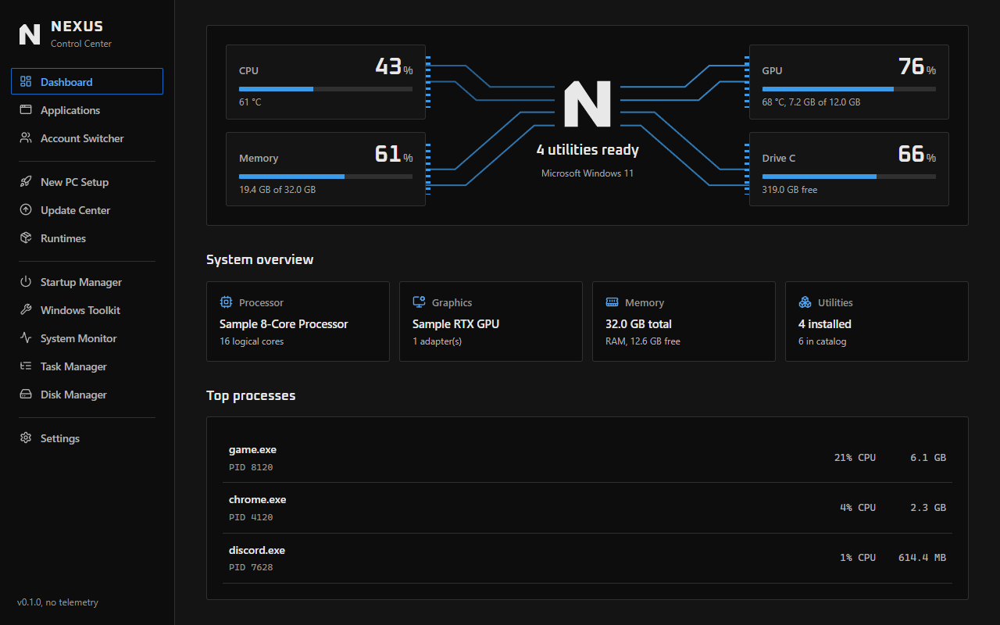
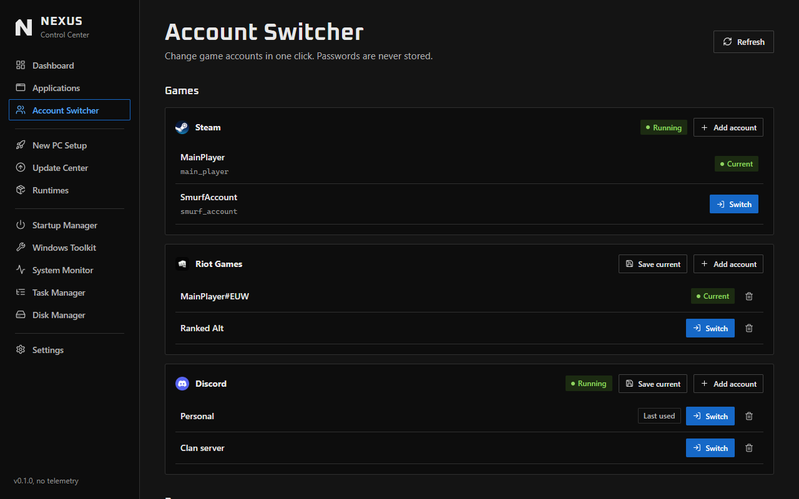
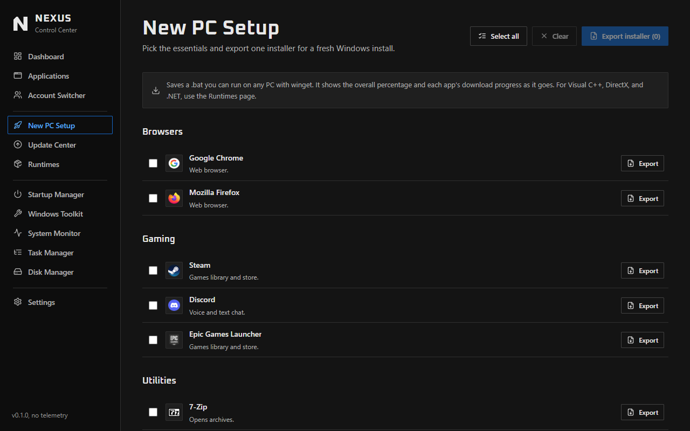
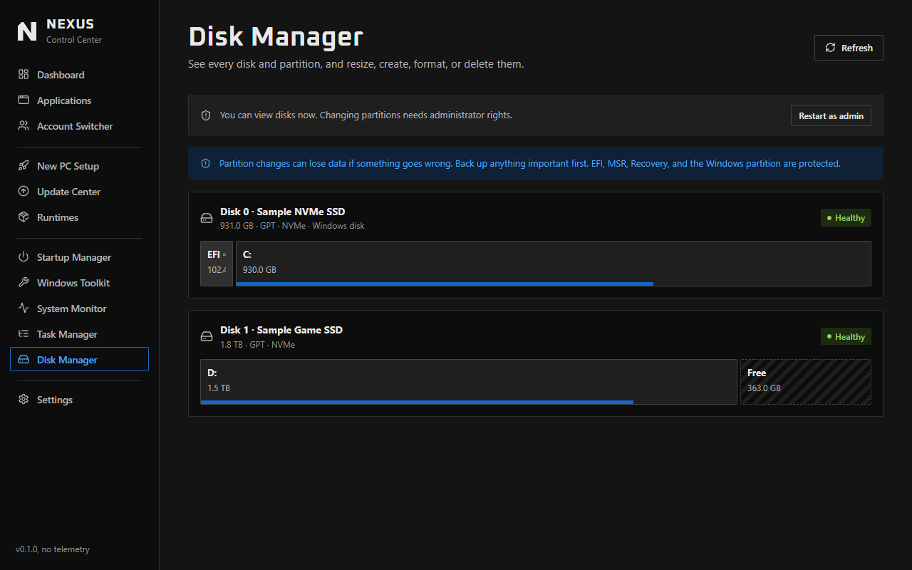
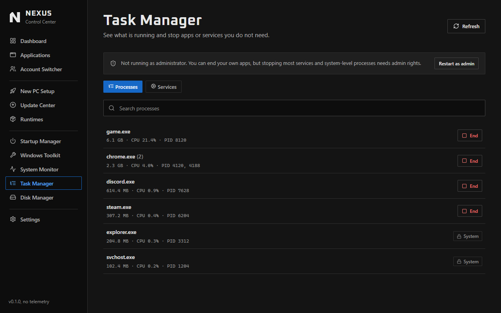
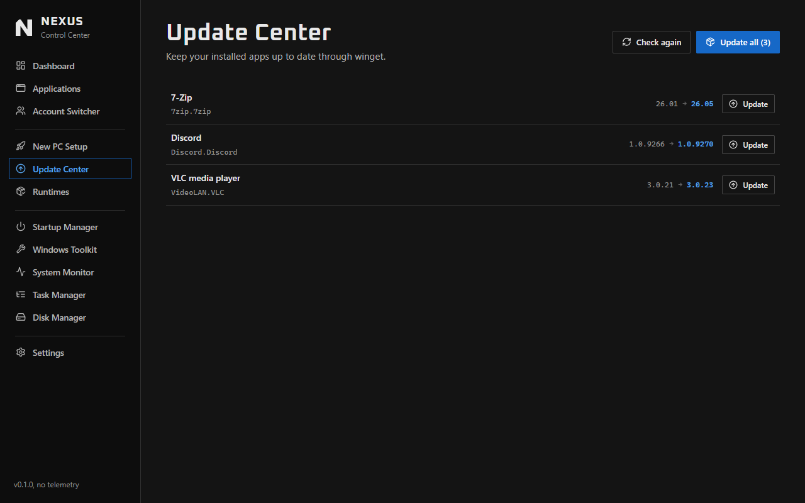
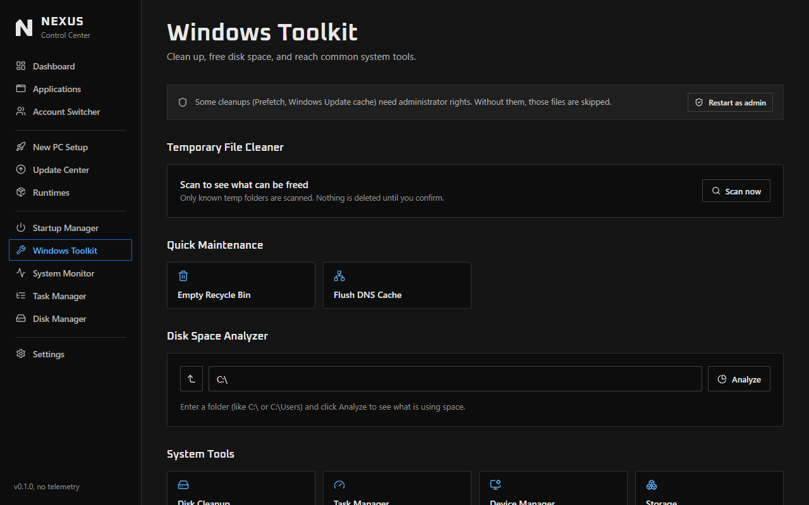

<p align="center">
  
</p>

<h1 align="center">NEXUS</h1>

<p align="center">One free, open source app for your whole PC. For Windows 10 and 11.</p>

<p align="center">
  <a href="https://opensourceguyatnexus.github.io/NEXUS/">Website</a> ·
  <a href="https://opensourceguyatnexus.github.io/NEXUS/demo/">Live demo</a> ·
  <a href="https://github.com/opensourceguyatnexus/NEXUS/releases/latest">Download</a> ·
  <a href="CONTRIBUTING.md">Contribute</a>
</p>



NEXUS is made to help anyone with a Windows PC, gamers and non-gamers alike. All of the code is public, and anyone can contribute.

## What it does

- **Account Switcher:** change Steam, Battle.net, Riot Games, Discord, Epic Games and Ubisoft Connect accounts in one click, and open browser profiles. Passwords are never stored, and saved logins stay on your PC.
- **New PC Setup:** tick the apps you want and export one installer that runs through winget.
- **Windows Toolkit:** see and clear temp files, empty the Recycle Bin, flush DNS and find what is using your disk.
- **Disk Manager:** resize, create, rename, format and delete partitions, with Windows and system partitions protected.
- **Task Manager:** end apps and control services, with core Windows processes protected.
- **Update Center and Runtimes:** update your apps, and install the Visual C++ and .NET packages games ask for.
- **Startup Manager and System Monitor:** turn off slow startup programs and watch live CPU, memory, disk and NVIDIA GPU stats.

NEXUS has no telemetry and no account. App logos are fetched from Google's favicon service.

Battle.net, Riot Games, Epic Games and Ubisoft Connect switching follows each launcher's known login files. It hasn't been fully tested on every launcher yet, so please report anything that doesn't work.

## Screenshots

| Account Switcher | New PC Setup |
|---|---|
|  |  |

| Disk Manager | Task Manager |
|---|---|
|  |  |

| Update Center | Windows Toolkit |
|---|---|
|  |  |

## Contribute

Anyone can help, and you don't need to be a programmer. Report a bug, suggest an idea, test a launcher, improve the docs or send code. See [CONTRIBUTING.md](CONTRIBUTING.md).

## Build it

You need Windows 10 or 11, [Node.js](https://nodejs.org) 22.12 or newer, [Rust](https://rustup.rs) (stable, MSVC toolchain) and the Microsoft C++ Build Tools. See the [Tauri prerequisites](https://tauri.app/start/prerequisites/).

```
npm install
npm run tauri dev
```

To build the app:

```
npm run tauri build -- --no-bundle
```

The exe is created at `src-tauri/target/release/nexus.exe`. Leave out `-- --no-bundle` to also build an installer into `src-tauri/target/release/bundle/nsis`.

Releases are built by `.github/workflows/release.yml`: pushing a version tag such as `v0.2.0` builds the exe and attaches it to a draft release. Pull requests are checked by `.github/workflows/ci.yml`.

To report a security problem, see [SECURITY.md](SECURITY.md).

## Website

The site in `website/` is published to GitHub Pages by `.github/workflows/pages.yml`. `npm run build:demo` builds the live demo into `website/demo` using only sample data.

The 3D logo uses [three.js](https://threejs.org) (MIT), kept in `website/vendor`.

## License

[MIT](LICENSE)
